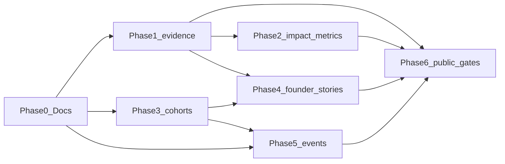

# ASIP CMS — Missing Tables Phased Plan

**Purpose:** Split Section 16 missing content types into ordered implementation phases.  
**Authority for field lists:** [`ASIP-CMS-Database-Schema.md`](./ASIP-CMS-Database-Schema.md)  
**Authority for applied DB:** [`Docs/[03] Database/schema.dbml`](../[03]%20Database/schema.dbml) + `supabase/migrations/`  
**Status:** Phase 0 (this document). Pick a phase number to implement next.

---

## 1. Purpose & hard rules

Every implementation phase must follow project rules:

1. **Append-only migrations** — never edit an already-applied migration. One logical change per new file.
2. **Do not alter already-migrated tables** — no `ALTER` on `startups`, `startup_details`, `blogs`, `partners`, `profiles`, `interest_registrations`, `contact_messages`, or `site_settings` in these phases.
3. **RLS in the same migration** — every new table enables RLS and ships policies before the migration ends. No table exists, even briefly, without RLS.
4. **Docs sync** — when a migration lands, update:
   - `Docs/[03] Database/schema.dbml`
   - `Docs/[03] Database/supabase-functions.md` (if triggers/RPCs/functions are added)
5. **Types** — regenerate `types/database.ts` via Supabase typegen (`supabase gen types typescript`). Do not hand-edit generated types.
6. **Architecture** — no Supabase in components. Layers: `app/` → `actions/` / `data/` → `lib/`. Shared Zod in `validations/`. Domain types in `types/`.
7. **Admin CRUD pattern** — mirror partners/blogs: RSC list page + create/edit UI, Server Actions with `authorizeAdmin()` (`getUser` + `rpc("is_admin")`), `revalidatePath` / `revalidateTag`, react-hook-form + zodResolver.
8. **FK mapping** — planned `founders` maps to existing **`startups`**. New FKs use `startups.id`, never invent a parallel `founders` table in these phases.
9. **Evidence owner** — planned `admin_users` maps to existing **`profiles.id`**.

---

## 2. Already integrated vs plan (do not alter)

Read-only gap report. These tables stay as-is unless a future, separate decision reopens them.

### 2.1 `startups` + `startup_details` vs planned `founders`

| Planned (`founders`) | Integrated today | Gap |
|---|---|---|
| Table name `founders` | `startups` + 1:1 `startup_details` | Naming only — keep `startups` |
| `founder_name`, `startup_name` | `name` + `startup_details.founder_names[]` | Split / array vs single required name |
| `one_line_proposition` | `description` (approx.) | Not a dedicated card/hero prop field |
| `country` / `sector` taxonomies | Free text / codes on details (`country_code`, `sector`) | No taxonomy tables |
| `cohort_year` → `cohorts` | `founded_at` + details `cohort` / `founding_year` text | No `cohorts` FK |
| Status: active / acquired / pivoted / closed / unverified | `startup_status`: draft / active / inactive | Different enum |
| `outcome_tags` multi | `public_outcome` text (approx.) | No taxonomy |
| `social_links` repeatable | — | Missing |
| `hero_image` + gallery 2–5 | `logo_url`, `cover_image_url` | No gallery model |
| `featured_on_homepage` | `featured` boolean on details | Present (later migration) |
| `publish_status` draft/published | Folded into `status` | Different model |

**Admin:** `/dashboard/portfolio` CRUD exists.  
**Decision:** Do not rename, reshape, or backfill into a new `founders` table in Phases 1–5.

### 2.2 `blogs` vs planned `articles`

| Planned (`articles`) | Integrated (`blogs`) | Gap |
|---|---|---|
| Fixed category streams (5) | `categories text[]` free-text | Streams not enforced |
| `related_founder` FK | — | Missing |
| `related_cohort` FK | — | Missing (needs Phase 3) |
| `sources` repeatable | — | Missing |
| CMS `meta_title` / `meta_description` | SEO from code / title+summary | Not CMS-editable columns |
| `publish_status` | `status` draft/published + `published_at` | Close enough |

**Admin:** `/dashboard/blogs` CRUD exists.  
**Decision:** Do not alter `blogs` in Phases 1–5. Optional later phase could add FKs once `cohorts` exists — only if Guy approves a new migration that *extends* blogs (out of this plan’s default scope).

### 2.3 `partners` vs planned `partners`

| Planned | Integrated | Gap |
|---|---|---|
| `organisation` | `org` | Naming |
| `partner_type` (singular labels) | `partner_type` enum (plural-ish: `investors`, `mentors`, …) | Enum labels differ |
| `role_contribution` | `contribution` | Naming |
| `status` active/historical | `is_active` boolean | Shape |
| `logo_permission_status` granted/pending/denied | `logo_permission` boolean | Coarser gate |
| `publish_status` draft/published | No separate column; public view + app gate logo | Missing draft/publish |
| `sort_order`, timestamps | Present | Extra (keep) |

**Admin:** `/dashboard/partners` + `/dashboard/partners/[id]` CRUD exists. RLS + `partners_public` view exist.  
**Note:** Task backlog §10/§16 still says partners are missing — **stale**. Partners are done for Phase 1 CMS purposes.

**Decision:** Do not alter `partners` in Phases 1–5.

### 2.4 Other existing tables (out of content-type phases)

| Planned | Integrated | Notes |
|---|---|---|
| `leads` | `interest_registrations` | Fewer fields; admin RUD at `/dashboard/registrations` |
| `applications` | — | Not built; gated by `site_settings.open_applications` on routes only |
| `admin_users` | `profiles` + `user_role` | Policies use `is_admin()` only (editor/viewer not differentiated in RLS) |
| `site_config` | `site_settings` (`open_applications` only) | No alumni/CEO/banner/newsletter CMS fields |
| `contact_routes` | `contact_enquiry_type` on `contact_messages` | Inbox routing not stored |
| `nav_items` | Code constants + middleware | No CMS nav table |
| Taxonomies (`sectors`, `countries`, `outcome_tags`) | Free text / enums | Not in Phases 1–5 |
| `newsletter_subscribers` | — | Not in Phases 1–5 |

---

## 3. Missing tables to build

| Planned table | Phase | Maps / depends on |
|---|---|---|
| `evidence_records` | **1** | `owner` → `profiles.id` |
| `impact_metrics` | **2** | `evidence_id` → `evidence_records` (req) |
| `cohorts` | **3** | M2M → `partners`, `startups`; later events |
| `founder_stories` | **4** | `startup_id` → `startups`; optional M2M → evidence |
| `events` | **5** | M2M → `startups`; optional link to cohorts |

**Junction tables (create with their owning phase):**

| Junction | Phase | Links |
|---|---|---|
| `cohort_partners` | 3 | `cohorts` ↔ `partners` |
| `cohort_startups` | 3 | `cohorts` ↔ `startups` |
| `founder_story_evidence` | 4 | `founder_stories` ↔ `evidence_records` |
| `event_startups` | 5 | `events` ↔ `startups` |
| `cohort_events` | 5 | `cohorts` ↔ `events` (optional if both phases done) |

---

## 4. Phased implementation

Dependency order (recommended). You may start any phase, but **Phase 2 requires Phase 1**. Phase 4 evidence links require Phase 1. Phase 5 cohort join requires Phase 3.

---

### Phase 0 — Docs + conventions lock (this file)

**Done when:** This MD is reviewed and a start phase is chosen.

- [x] Document gap vs integrated tables
- [x] Lock “do not alter” list
- [x] Define phase order and checklists
- [ ] User picks Phase 1–5 (or 6) to implement

---

### Phase 1 — `evidence_records` + admin CRUD

**Why first:** Governance root. Impact metrics require an evidence FK; founder stories optionally link claims here.

#### Migration (new file only)

Suggested name: `supabase/migrations/YYYYMMDDHHMMSS_create_evidence_records.sql`

**Enums (examples — align names with Postgres style used elsewhere):**

- `evidence_status`: `verified` | `pending` | `outdated` | `disputed` | `not_for_publication`
- `evidence_permission`: `public` | `internal_only` | `partner_approval_required` | `legal_review_required`

**Columns (from CMS schema §5):**

| Column | Type | Notes |
|---|---|---|
| `id` | uuid PK | `gen_random_uuid()` |
| `primary_source` | text | Required; optional later: storage path for file |
| `source_file_url` | text nullable | Optional upload URL if we add bucket |
| `measurement_period_start` | date | Required |
| `measurement_period_end` | date | Required; CHECK end ≥ start |
| `owner_id` | uuid FK → `profiles(id)` | Required |
| `status` | `evidence_status` | Required |
| `last_verified_date` | date | Required |
| `permission` | `evidence_permission` | Required |
| `review_date` | date | Required |
| `created_at` / `updated_at` | timestamptz | Trigger on update |

**RLS:**

- Enable RLS on create.
- Grants: authenticated SELECT/INSERT/UPDATE/DELETE; service_role full; **no anon write**.
- Policies: admin-only SELECT/INSERT/UPDATE/DELETE via `is_admin()` (governance is internal — do not expose all evidence to anon in Phase 1).

**App layers:**

| Layer | Path |
|---|---|
| Types | `types/evidence-record.ts` |
| Validations | `validations/evidence-record.ts` (+ Vitest) |
| Data | `data/evidence-records.ts` — list page + getByIdForAdmin |
| Actions | `actions/evidence-records.ts` — create/update/delete |
| UI | `components/evidence-records/*` |
| Routes | `/dashboard/evidence`, `/dashboard/evidence/[id]` (dialog create OK, partners-style) |
| Nav | `constants/routes.ts`, `constants/dashboard-nav.ts`, `app-sidebar` icons |
| Loading | colocated `loading.tsx` + `RouteSkeleton` |

**Docs / types:**

- [ ] Update `schema.dbml`
- [ ] Update `supabase-functions.md` if trigger added
- [ ] Regenerate `types/database.ts`
- [ ] `npm test` + `npm run typecheck` + `npm run lint` for touched files

**Publish gate (enforce in Zod / actions later for consumers):** only `status = verified` may back live metrics (Phase 2/6).

---

### Phase 2 — `impact_metrics` + admin CRUD

**Depends on:** Phase 1.

#### Migration

Suggested name: `..._create_impact_metrics.sql`

**Enums:**

- `impact_lens`: `pipeline` | `inclusion` | `business_growth` | `commercialisation` | `jobs_capability` | `sector_outcomes`
- Reuse or mirror evidence-like publish enum: `verified` | `pending` | `outdated` | `disputed` | `not_for_publication` (may share `evidence_status` or dedicated `impact_publish_status`)

**Columns (CMS schema §4):**

| Column | Type | Notes |
|---|---|---|
| `id` | uuid PK | |
| `claim_label` | text | Required |
| `value` | text | Required (supports `"10,000+"`, `"70%"`) |
| `unit` | text nullable | |
| `period_start` / `period_end` | date | Required |
| `geography` | text nullable | |
| `impact_lens` | enum nullable | |
| `display_locations` | text[] nullable | e.g. homepage module, impact page |
| `evidence_id` | uuid FK → `evidence_records` **NOT NULL** | Every metric links to one |
| `publish_status` | enum | Only `verified` may render live |
| timestamps | | |

**RLS:**

- Admin full CRUD via `is_admin()`.
- Optional anon/authenticated SELECT: `publish_status = 'verified'` only (or defer public SELECT to Phase 6 and keep admin-only until then).

**App:** `/dashboard/impact-metrics` (+ detail/edit), same layer pattern as Phase 1. Form must require selecting an evidence record.

**Docs / typegen / tests** — same checklist as Phase 1.

---

### Phase 3 — `cohorts` + join tables + admin CRUD

**Depends on:** nothing strictly; recommended after Phase 0. Uses existing `partners` and `startups` without altering them.

#### Migration

Suggested name: `..._create_cohorts.sql`

**Enums:**

- `cohort_programme_status`: `closed` | `open` | `hold`
- `cms_publish_status`: `draft` | `published` (reuse across cohorts/stories/events if desired)

**Columns (CMS schema §3):**

| Column | Type | Notes |
|---|---|---|
| `id` | uuid PK | |
| `year` | int | Required; unique or unique(year, public_label) |
| `public_label` | text | Required (e.g. “2025 Portfolio Support Year”) |
| `programme_dates_start` / `end` | date nullable | VERIFY before publish |
| `programme_status` | enum | Required |
| `summary` | text nullable | |
| `media_url` | text nullable | Keep simple URL; bucket optional later |
| `publish_status` | draft/published | Required |
| timestamps | | |

**Junctions (RLS on each):**

- `cohort_partners (cohort_id, partner_id)` PK composite
- `cohort_startups (cohort_id, startup_id)` PK composite

**RLS:** admin write; public SELECT only where `publish_status = 'published'` (or admin-only until Phase 6).

**App:** `/dashboard/cohorts` — form with multi-select partners/startups.

**Docs / typegen / tests** — same checklist.

---

### Phase 4 — `founder_stories` + admin CRUD

**Depends on:** Phase 1 if wiring evidence M2M; always FKs to `startups`.

#### Migration

Suggested name: `..._create_founder_stories.sql`

**Enums:**

- `quote_permission_status`: `granted` | `pending` | `denied`
- `cms_publish_status`: draft/published

**Columns (CMS schema §2):**

| Column | Type | Notes |
|---|---|---|
| `id` | uuid PK | |
| `startup_id` | uuid FK → `startups` **NOT NULL** | Planned `founder_id` |
| `the_problem` | text | Required |
| `what_they_built` | text | Required |
| `the_asip_connection` | text | Required |
| `where_they_are_now` | text | Required |
| `founder_quote_text` | text nullable | |
| `quote_attribution_name` | text nullable | Required if quote present (CHECK/Zod) |
| `quote_attribution_title` | text nullable | |
| `quote_date` | date nullable | |
| `quote_permission_status` | enum nullable | Required if quote present |
| `publish_status` | draft/published | |
| timestamps | | |

**Junction:** `founder_story_evidence (story_id, evidence_id)` — only if Phase 1 done.

**RLS:** admin CRUD; public SELECT published only (Phase 6 may refine quote stripping in app layer).

**App:** `/dashboard/founder-stories` — select startup; rich text or textarea matching other admin forms.

**Publish gate (Zod + UI):** quote block invalid unless attribution + `quote_permission_status = granted` when publishing quote to public (Phase 6). Story may publish without quote.

**Note:** Do not remove or alter `startup_details.problem` / `solution` in this phase — stories are additive.

---

### Phase 5 — `events` + admin CRUD

**Depends on:** Phase 3 only if creating `cohort_events`.

#### Migration

Suggested name: `..._create_events.sql`

**Enums:**

- `event_format`: `virtual` | `in_person` | `hybrid`
- `cms_publish_status`: draft/published

**Columns (CMS schema §8):**

| Column | Type | Notes |
|---|---|---|
| `id` | uuid PK | |
| `name` | text | Required |
| `event_date` | date | Required (`date` is reserved-ish — prefer `event_date`) |
| `location` | text nullable | |
| `format` | enum nullable | |
| `speakers` | text[] nullable | |
| `assets` | text[] nullable | URLs; bucket optional later |
| `outcomes` | text nullable | |
| `publish_status` | draft/published | |
| timestamps | | |

**Junctions:**

- `event_startups (event_id, startup_id)`
- `cohort_events (cohort_id, event_id)` if Phase 3 exists

**RLS / app / docs:** same pattern → `/dashboard/events`.

---

### Phase 6 — Public reads & publish gates (optional follow-on)

**Out of default “tables + admin” scope** unless requested.

- Wire Home Module 02 / Impact page to `impact_metrics` where `publish_status = verified` and evidence exists.
- Wire founder profile modules to published `founder_stories`; strip quotes unless `quote_permission_status = granted`.
- Wire cohort labels / programme filters from published `cohorts` (without altering `startup_details.cohort` text until a later migration is approved).
- Cache tags + narrow selects; Server Components only for first paint.
- Do **not** hardcode new live metrics that bypass evidence.

---

## 5. Per-phase delivery checklist (copy into each PR)

Use this for Phases 1–5:

1. [ ] New migration only (no edits to old SQL)
2. [ ] Table(s) + enums + indexes + `updated_at` trigger
3. [ ] RLS enabled + grants + `is_admin()` policies in same file
4. [ ] Junction tables (if any) with RLS
5. [ ] `schema.dbml` updated
6. [ ] `supabase-functions.md` updated if needed
7. [ ] `supabase gen types` → `types/database.ts`
8. [ ] `types/`, `validations/` (+ Vitest), `data/`, `actions/`
9. [ ] Dashboard page(s) + `loading.tsx` + nav + routes
10. [ ] Mobile-first admin UI (tables `overflow-x-auto`, full-width controls on small screens)
11. [ ] `npm test`, `npm run typecheck`, `npm run lint` clean for the change

---

## 6. Explicitly out of scope (Phases 1–5)

- Altering `startups`, `startup_details`, `blogs`, `partners`, or form/settings tables
- Creating taxonomy tables (`sectors`, `countries`, `outcome_tags`)
- Creating `applications` or reshaping `interest_registrations` into full `leads`
- `nav_items`, full `site_config`, newsletter subscribers
- Splitting RLS by `editor` / `viewer` (keep `is_admin()` until a dedicated permissions phase)
- Public marketing wiring (Phase 6 — opt-in)
- Renaming `blogs` → `articles` or `startups` → `founders`

---

## 7. How to proceed

Reply with one of:

- `start Phase 1` — evidence_records  
- `start Phase 2` — impact_metrics (requires Phase 1 done)  
- `start Phase 3` — cohorts  
- `start Phase 4` — founder_stories  
- `start Phase 5` — events  
- `start Phase 6` — public gates  

Recommended first implementation: **Phase 1**.

---

*Companion to [`ASIP-CMS-Database-Schema.md`](./ASIP-CMS-Database-Schema.md). Reflects codebase state as of plan authoring; re-check migrations before implementing if the branch moved on.*
